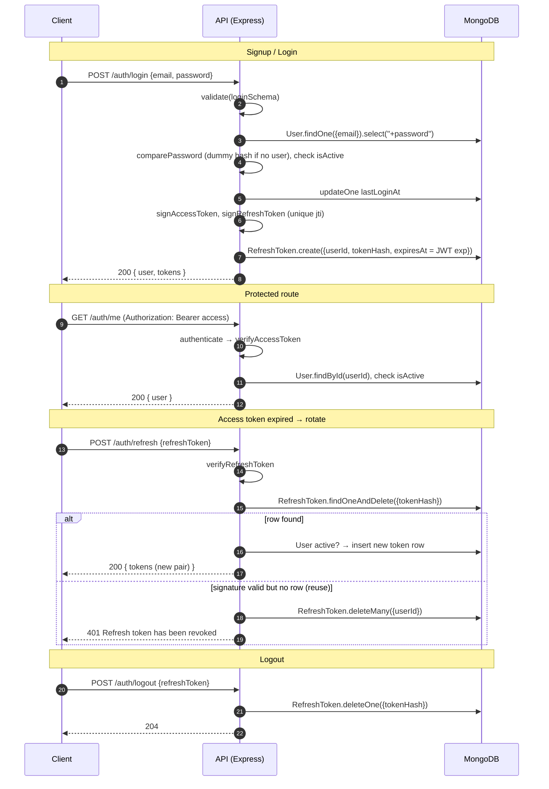
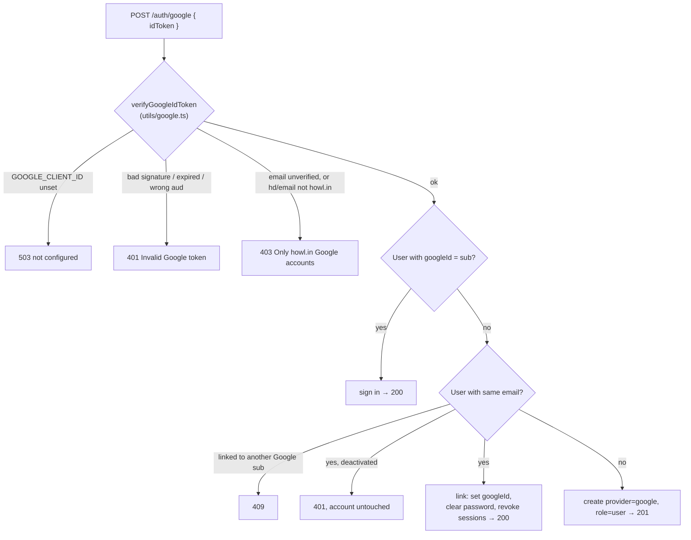
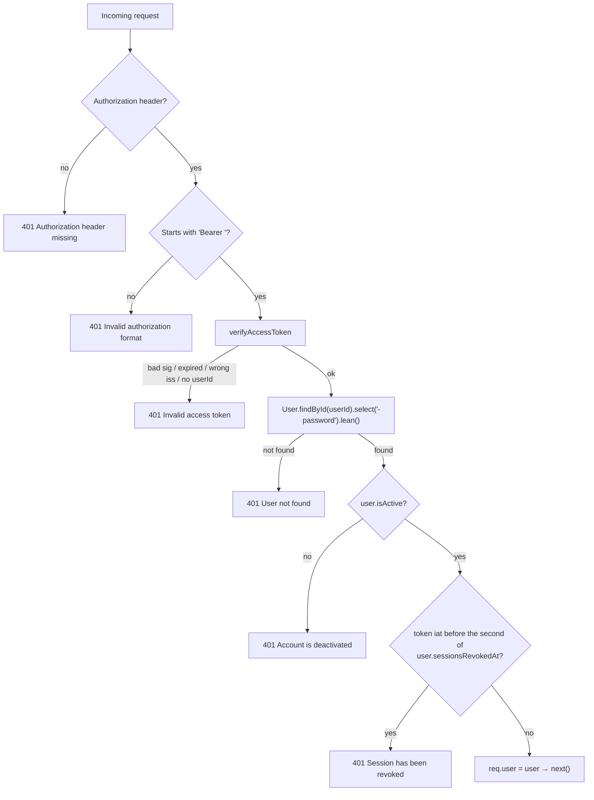

# Authentication

> **Status (as of 2026-10-05): live.** Email + password auth (any domain) and **Sign in with Google (howl.in only)**, with JWT access tokens and rotating refresh tokens. Eight endpoints under `/auth` (including profile update and set/change password), all documented in Swagger at `/docs`.
>
> Not built yet: forgot-password (email reset), enforcement of `accessScopes`, and login rate limiting (see §9).

To test it by hand (including real Google tokens via the OAuth Playground), follow [guides/testing-auth.md](../guides/testing-auth.md).

Swagger (`/docs`) is the source of truth for request and response details. This document explains the design, how the pieces fit together, and what's left to do.

---

## 1. The design in one paragraph

CSAT uses **stateless JWT access tokens** plus **stateful, single-use refresh tokens**. After signup or login the client holds two tokens:

- A short-lived **access token** (default 15 min). The client sends it as `Authorization: Bearer <token>` on protected calls.
- A long-lived **refresh token** (default 30 days). The client trades it for a **new pair** when the access token expires. The server stores only a **SHA-256 hash** of each refresh token. Every refresh deletes the old token (rotation). Presenting an old token again is treated as theft and revokes every session.

Passwords are stored as **bcrypt(HMAC-SHA256(password, pepper))**.

---

## 2. Endpoints

| Method  | Path               | Auth                    | Body                                                                          | Success                      | Errors                  |
| ------- | ------------------ | ----------------------- | ----------------------------------------------------------------------------- | ---------------------------- | ----------------------- |
| `POST`  | `/auth/signup`     | Public                  | `name`, `email`, `password`, `mobileNumber?`                                  | `201 { user, tokens }`       | 400, 409                |
| `POST`  | `/auth/login`      | Public                  | `email`, `password`                                                           | `200 { user, tokens }`       | 400, 401                |
| `POST`  | `/auth/refresh`    | Refresh token in body   | `refreshToken`                                                                | `200 { tokens }`             | 400, 401                |
| `POST`  | `/auth/logout`     | Refresh token in body   | `refreshToken`                                                                | `204`                        | 400                     |
| `POST`  | `/auth/logout-all` | **Bearer**              | –                                                                             | `204`                        | 401                     |
| `GET`   | `/auth/me`         | **Bearer**              | –                                                                             | `200 { user }`               | 401                     |
| `PATCH` | `/auth/me`         | **Bearer**              | `name?`, `mobileNumber?`, `profileImage?`, `currentPassword?`, `newPassword?` | `200 { user, tokens? }`      | 400, 401, 409           |
| `POST`  | `/auth/google`     | Google ID token in body | `idToken`                                                                     | `201`/`200 { user, tokens }` | 400, 401, 403, 409, 503 |

`tokens` = `{ tokenType: "Bearer", accessToken, expiresIn, refreshToken, refreshTokenExpiresAt }`. `user` is the public user. It never includes `password`, `googleId` or `__v`, and it carries `hasPassword` and `googleLinked` so the frontend knows which sign-in methods the account has. Google sign-in has its own section, §3.

### Behaviour worth knowing

- **Signup** always creates `provider: "local"`, `role: "user"`, and signs the user straight in. The body is strict, so `role`/`isActive`/`accessScopes`/`provider` are rejected with a 400. Emails are trimmed and lowercased, so `Priya@X.com` and `priya@x.com` count as the same account (409).
- **Login** returns the same `401 Invalid email or password` **in the same time** for an unknown email, a wrong password, or a Google account with no password. Unknown emails are still compared against a dummy bcrypt hash, so response timing doesn't reveal which emails are registered. `Account is deactivated` is only returned after the password matches. A successful login sets `lastLoginAt`.
- **Refresh** atomically consumes the presented token (`findOneAndDelete`) and issues a new pair. If the token's signature is valid but it's no longer stored (already used or logged out), **all of that user's refresh tokens are deleted** and a `401 Refresh token has been revoked` is returned. A deactivated user's tokens are also all revoked.
  - **Exception:** a deliberate revoke-all (`/auth/logout-all`, or Google being linked) stamps `user.sessionsRevokedAt`. A token issued before that time just gets the 401, and newer sessions are **not** revoked. Otherwise a stale old device could log the user out of their fresh session.
- **Logout** is idempotent: an unknown or already-revoked token still returns 204.
- **Access tokens after logout:** a single-device `logout` can't revoke the access token; it keeps working for up to `JWT_ACCESS_TTL` (15 min). A **revoke-all** is different: `logout-all`, a password set/change, and Google linking all stamp `sessionsRevokedAt`, and `authenticate` then rejects any access token issued in an earlier second (`401 Session has been revoked`). `authenticate` also reloads the user on every request, so **deactivating or deleting a user cuts them off immediately**.

### Profile & password (`PATCH /auth/me`)

The user can only edit **their own** profile. The user ID comes from the verified access token; there's no ID in the path, and the strict body rejects `email`, `role`, `isActive`, `_id` and every other server-owned field.

| Field             | Rule                                                           |
| ----------------- | -------------------------------------------------------------- |
| `name`            | Trimmed, 2–100 characters                                      |
| `mobileNumber`    | E.164; `null` removes it                                       |
| `profileImage`    | **https** URL only, ≤ 2048 characters; `null` removes it       |
| `newPassword`     | Signup policy: 8+ characters, a letter and a digit, ≤ 72 bytes |
| `currentPassword` | Only with `newPassword`                                        |

**Password rules:**

| Account                                              | Send                              | Result                                                           |
| ---------------------------------------------------- | --------------------------------- | ---------------------------------------------------------------- |
| No password (`hasPassword: false`, e.g. Google-only) | `newPassword`                     | Password **set**                                                 |
| No password                                          | `currentPassword` + `newPassword` | `400 No password is set for this account — omit currentPassword` |
| Has a password                                       | `newPassword` only                | `400 currentPassword is required to change the password`         |
| Has a password                                       | wrong `currentPassword`           | `400 Current password is incorrect`                              |
| Has a password                                       | `newPassword` same as current     | `400 New password must be different from the current password`   |
| Has a password                                       | correct `currentPassword` + new   | Password **changed**                                             |

How it stays safe:

- **Nothing is saved unless everything passes.** All checks run first, then one database update writes every field. A wrong current password leaves `name` and the rest untouched too.
- **No double write.** The password update only matches if the stored hash is still the one that was verified (or still empty, for a first set). If two requests race, one wins and the other gets `409 Password was changed by another request; reload and try again`.
- **Other devices are logged out.** Setting or changing the password revokes every session (refresh tokens deleted, older access tokens rejected) and returns a **fresh `tokens` pair** for the calling device. The client must store it. Profile-only updates return just `{ user }` and leave sessions alone.
- **A wrong current password is a 400, not a 401,** so frontends don't mistake it for an expired session and log the user out.
- The new password is stored with the usual `hashPassword` (HMAC-pepper + bcrypt) and is never logged.
- **Known limit:** JWT `iat` has whole-second precision. An access token issued in the **same second** as the revoke is still accepted, so that the fresh pair isn't rejected. That window is under one second.

### Flow



---

## 3. Sign in with Google (howl.in only)

One endpoint, `POST /auth/google`, handles both **sign-up and sign-in**. The frontend shows Google's sign-in button, receives an **ID token**, and posts it to the API. The API verifies it and returns **our own** `{ user, tokens }`, exactly like `/auth/login`. After that, refresh, logout and `/me` work the same for every user.

**Domain rule:** only Google Workspace accounts on `GOOGLE_ALLOWED_DOMAINS` (default `howl.in`) are accepted, for sign-up _and_ sign-in. Normal `/auth/signup` is not restricted.



**How the token is checked** (`utils/google.ts`, using Google's official `google-auth-library`):

1. Signature against Google's rotating certificates, `aud` equal to `GOOGLE_CLIENT_ID`, issuer is Google, not expired.
2. `email_verified` is true.
3. The `hd` (hosted domain) claim is an allowed domain. Only Workspace accounts have `hd`, so personal Gmail accounts are rejected.
4. The email itself ends in that domain.

Users are matched by Google's **`sub`** (stable, never reused), not by email.

### One person = one account

| Situation                                                       | Result                                                                              |
| --------------------------------------------------------------- | ----------------------------------------------------------------------------------- |
| First Google sign-in, no account                                | New account: `provider: "google"`, `hasPassword: false`, `googleLinked: true` (201) |
| Google sign-in again                                            | Same account (200)                                                                  |
| Password account exists with the same email                     | Google is **linked** to that same account (200): see below                          |
| Google account exists, then password signup with the same email | 409 `Email is already registered`, so no second account                             |
| Google-only account tries password login                        | Generic 401 `Invalid email or password` (until "set password" exists)               |

**Why linking clears the password (pre-registration takeover).** Password signup never verifies that the person owns the email. An attacker could register `someone@howl.in` with their own password before the real owner ever uses Google. When Google later proves who owns the address, keeping that password would leave the attacker a way in. So on linking, the old password is removed and all existing sessions are revoked. The account (same `_id`, role and profile) stays; the owner can set a fresh password through the upcoming set-password flow.

### Setup

1. **Google Cloud Console → APIs & Services → OAuth consent screen.** If `howl.in` is a Google Workspace domain, choose **Internal**; Google then blocks outside accounts before they reach us.
2. **Credentials → Create OAuth client ID → Web application.** Add the frontend URLs (e.g. `http://localhost:3000`) as _Authorized JavaScript origins_. No redirect URIs or client secret are needed.
3. Set `GOOGLE_CLIENT_ID` in `.env` (same value in the frontend; it isn't secret). Optionally set `GOOGLE_ALLOWED_DOMAINS`.
4. If the frontend runs on another origin, set `CORS_ORIGINS` (comma-separated). CORS is off by default.

### Frontend

```js
// <script src="https://accounts.google.com/gsi/client" async></script>
google.accounts.id.initialize({
  client_id: GOOGLE_CLIENT_ID,
  hd: "howl.in", // UI hint only; the server enforces the domain
  callback: async ({ credential }) => {
    const res = await fetch(`${API}/auth/google`, {
      method: "POST",
      headers: { "content-type": "application/json" },
      body: JSON.stringify({ idToken: credential }),
    });
    // 200/201 → { user, tokens }: store like /auth/login
    // 403 → not a howl.in Google account
  },
});
google.accounts.id.renderButton(el, {
  theme: "outline",
  text: "continue_with",
});
```

---

## 4. Where everything lives

All paths are relative to `services/api/src/` unless noted. The code follows the usual route → controller → service → model layering.

| Concern               | File                                                                  | What it does                                                                                                                               |
| --------------------- | --------------------------------------------------------------------- | ------------------------------------------------------------------------------------------------------------------------------------------ |
| Routes + Swagger      | `routes/auth.ts`                                                      | The seven `/auth/*` routes, each with its `validate(...)`/`authenticate` middleware and full `@openapi` annotation                         |
| Controllers           | `controllers/auth.ts`                                                 | Map HTTP to the service: status codes and response bodies                                                                                  |
| Service               | `services/auth.ts`                                                    | All auth logic: signup, login, refresh (rotation + reuse detection), logout, logout-all, Google sign-in/linking, `toPublicUser` serializer |
| Google verification   | `utils/google.ts`                                                     | `verifyGoogleIdToken`: ID-token check plus the howl.in domain rule                                                                         |
| Config / secrets      | `packages/shared/src/config.ts`                                       | JWT secrets/TTLs and `PASSWORD_PEPPER` (required), plus `GOOGLE_CLIENT_ID`, `GOOGLE_ALLOWED_DOMAINS` and `CORS_ORIGINS` (optional)         |
| CORS                  | `app.ts`                                                              | Allowlist from `CORS_ORIGINS`; off when empty                                                                                              |
| User model            | `models/user.ts`                                                      | Identity, `password` (`select: false`), `provider`, `googleId`, `role`, `accessScopes`, `isActive`, `lastLoginAt`, `sessionsRevokedAt`     |
| Refresh-token model   | `models/refresh-token.ts`                                             | `{ userId, tokenHash, expiresAt }`, with a TTL index                                                                                       |
| Input contracts       | `dto/auth.dto.ts`                                                     | Zod `signupSchema`, `loginSchema`, `refreshSchema`                                                                                         |
| Validation middleware | `middlewares/validate.ts`                                             | `validate(schema)` → 400 `ValidationError`                                                                                                 |
| Password hashing      | `utils/password.ts`                                                   | `hashPassword`, `comparePassword`                                                                                                          |
| Token utilities       | `utils/jwt.ts`                                                        | `sign*/verify*Token`, `hashToken`, `getTokenExpiry`                                                                                        |
| Auth middleware       | `middlewares/authenticate.ts`                                         | `authenticate` (Bearer → `req.user`) and `requireRole([...])`                                                                              |
| Errors                | `utils/errors.ts` + `middlewares/error-handler.ts`                    | 400 / 401 / 403 / 409 / 500 mapping; `ServiceUnavailableError` is the only 5xx whose message is shown to clients                           |
| API docs              | `docs/openapi.ts`, `docs/components.ts` + `packages/http/src/docs.ts` | Swagger UI at `/docs`, spec at `/openapi.json` (see §8)                                                                                    |

---

## 5. Configuration

From `.env.example`:

```env
JWT_ACCESS_SECRET=          # REQUIRED – HMAC key for access tokens
JWT_REFRESH_SECRET=         # REQUIRED – HMAC key for refresh tokens (must differ from access)
JWT_ACCESS_TTL=15m          # optional, default 15m
JWT_REFRESH_TTL=30d         # optional, default 30d
PASSWORD_PEPPER=            # REQUIRED – never change once users exist
GOOGLE_CLIENT_ID=           # optional – Web OAuth client ID; empty → /auth/google returns 503
GOOGLE_ALLOWED_DOMAINS=howl.in  # optional – comma-separated Workspace domains for Google sign-in
CORS_ORIGINS=               # optional – comma-separated browser origins; empty → CORS off
```

- Missing secrets throw at startup. No weak default key is ever used.
- **If you change `PASSWORD_PEPPER`, every existing password hash stops working.** Treat it like a database encryption key.
- CI reads these values from the GitHub secrets `CI_JWT_ACCESS_SECRET`, `CI_JWT_REFRESH_SECRET` and `CI_PASSWORD_PEPPER`.

---

## 6. Data model

### `User`

```ts
{
  name, email (unique, lowercase), mobileNumber?, profileImage?,
  password?: string        // bcrypt hash; select:false; absent = no password login
  provider: "local" | "google"  // how the account was CREATED (unchanged by linking)
  googleId?: string        // Google `sub`; unique + sparse; set when Google is linked
  role: "admin" | "user"   // default "user"
  accessScopes: [{ resourceType: "sbu" | "department", resourceId }]
  isActive: boolean        // default true
  lastLoginAt?: Date       // set on signup and every login (password or Google)
  sessionsRevokedAt?: Date // last deliberate revoke-all (logout-all, Google linking)
}
```

The email `match` uses the same regex as the signup DTO (`z.regexes.email`), so any address the API accepts can be saved, `user+tag@example.com` included. Responses go through `toPublicUser` in `services/auth.ts`, an explicit field allowlist, so the password hash can never be serialised.

### `RefreshToken`

```ts
{ userId → User, tokenHash (unique, sha256 hex), expiresAt, createdAt, updatedAt }
```

- `expiresAt` is copied from the JWT's own `exp` (`getTokenExpiry`), so the **TTL index** deletes the row exactly when the token stops verifying.
- The **compound index** `{ userId, expiresAt }` backs logout-all and reuse revocation.

---

## 7. How each piece works

### 7.1 Password hashing (`utils/password.ts`)

```
stored = bcrypt( HMAC-SHA256(key = PEPPER, msg = password) → base64, cost = 12 )
```

- **Why the HMAC step first?** bcrypt ignores everything after 72 bytes. Pre-hashing turns any password into a 44-byte value that always includes the pepper.
- **Pepper:** a secret kept outside the database. If the database leaks without the server config, the hashes can't be cracked offline.
- `comparePassword` repeats the same HMAC step and calls `bcrypt.compare`, which compares in constant time.

### 7.2 Tokens (`utils/jwt.ts`)

|                     | Access token           | Refresh token                             |
| ------------------- | ---------------------- | ----------------------------------------- |
| Secret              | `JWT_ACCESS_SECRET`    | `JWT_REFRESH_SECRET`                      |
| Lifetime            | `JWT_ACCESS_TTL` (15m) | `JWT_REFRESH_TTL` (30d)                   |
| Payload             | `{ userId }`           | `{ userId }` + unique `jti`               |
| Issuer (`iss`)      | `csat-api`             | `csat-api`                                |
| Stored server-side? | No                     | Yes, as `sha256(token)` in `RefreshToken` |

- **Payload allowlist:** only `userId` goes into a token (Semgrep's `jwt-exposed-data` rule enforces this in CI).
- **`jti`:** a random UUID on every refresh token. Without it, two tokens issued to the same user in the same second would be identical and collide on the unique `tokenHash` index.
- `verify*Token` checks the signature, expiry, issuer and `userId`. Any failure becomes a 401.

### 7.3 Input validation (`dto/auth.dto.ts`)

Every schema is `.strict()`, so unknown keys are rejected (mass-assignment defence).

| Schema          | Used by                         | Rules                                                                                                                   |
| --------------- | ------------------------------- | ----------------------------------------------------------------------------------------------------------------------- |
| `signupSchema`  | `/auth/signup`                  | name 2–100 chars; email trimmed, lowercased, valid; password 8+ chars, a letter and a digit, max 72 bytes; mobile E.164 |
| `loginSchema`   | `/auth/login`                   | password only non-empty (the policy isn't revealed)                                                                     |
| `refreshSchema` | `/auth/refresh`, `/auth/logout` | non-empty string                                                                                                        |

### 7.4 `authenticate` middleware



### 7.5 `requireRole(roles)` middleware

Use it after `authenticate`. If the user's role isn't in the list, it returns **403** "Insufficient permissions". No route uses it yet; it's ready for admin-only features.

---

## 8. Swagger / API docs

| Route               | Serves                                                              |
| ------------------- | ------------------------------------------------------------------- |
| `GET /docs`         | Swagger UI (`301` → `/docs/`); has its own CSP, scoped to this path |
| `GET /openapi.json` | The raw OpenAPI 3.0.3 spec                                          |

**Trying auth in Swagger:** run `POST /auth/signup`, `POST /auth/login` or `POST /auth/google` (needs a real Google ID token), copy `tokens.accessToken`, click **Authorize** and paste it in (without `Bearer `). Padlocked routes (`/auth/me`, `/auth/logout-all`) then send it.

### What the spec contains

| Part               | Contents                                                                                                                                                                                         |
| ------------------ | ------------------------------------------------------------------------------------------------------------------------------------------------------------------------------------------------ |
| `info.description` | Route table, step-by-step auth guide, error status codes, 100 kb body limit                                                                                                                      |
| `tags`             | `Health`, `Auth`, `Docs`                                                                                                                                                                         |
| `paths`            | All 10 operations: `/health`, the 7 `/auth/*` routes, `/openapi.json`, `/docs`                                                                                                                   |
| `securitySchemes`  | `bearerAuth` (HTTP bearer JWT), applied only to `/auth/me` and `/auth/logout-all`                                                                                                                |
| `schemas`          | `HealthReport`, `ErrorResponse`, `User`, `AccessScope`, `SignupRequest`, `LoginRequest`, `RefreshRequest`, `GoogleAuthRequest`, `AuthTokens`, `AuthResponse`, `RefreshResponse`, `MeResponse`    |
| `responses`        | `BadRequest`, `Unauthorized`, `Forbidden`, `NotFound`, `EmailConflict`, `GoogleDomainForbidden`, `GoogleNotConfigured`, `InternalServerError`, each with the **exact** messages the code returns |

### How it's built

| File                                  | Role                                                                                          |
| ------------------------------------- | --------------------------------------------------------------------------------------------- |
| `services/api/src/docs/openapi.ts`    | Base definition (info, servers, tags), plus `@openapi` blocks for `/docs` and `/openapi.json` |
| `services/api/src/docs/components.ts` | All reusable components, each with a comment naming the code it mirrors                       |
| `services/api/src/routes/*.ts`        | `@openapi` block above each route                                                             |
| `packages/http/src/docs.ts`           | `buildOpenApiSpec` (globs converted to forward slashes for Windows) and `mountDocs`           |

### Keeping Swagger honest

These tests fail if the docs drift from the code:

- **Routes:** the documented `METHOD path` pairs must equal the routes Express has actually registered (`tests/unit/api/docs.test.ts`).
- **Security:** exactly the `authenticate`-protected operations carry `bearerAuth`.
- **Requests:** `Signup/Login/Refresh/GoogleAuthRequest` must contain every constraint in `z.toJSONSchema()` of their DTOs.
- **Responses:** the integration tests check real auth responses against the `AuthResponse`, `User`, `AuthTokens`, `RefreshResponse` and `MeResponse` keys: every required key present, no undocumented keys.
- **References:** every `$ref` resolves.

To add a protected route, put `security: [{ bearerAuth: [] }]` and `401: { $ref: '#/components/responses/Unauthorized' }` in its annotation, then add it to the expected lists in `docs.test.ts`.

---

## 9. Remaining gaps

1. **No rate limiting or lockout on `/auth/login`, `/auth/signup` and `/auth/google`.** Needed before going public to slow down password guessing (e.g. `express-rate-limit`, per IP + per email).
2. **No "forgot password".** A user who doesn't know their current password can't reset it; that needs an email service for reset links. Changing **email** isn't supported either, since it would need re-verification. Include `PATCH /auth/me` in the rate limiting from item 1, because it checks `currentPassword`.
3. **`accessScopes`** (SBU/department access) is stored but never checked. It needs a `requireScope(...)` middleware once those resources exist.
4. **No way to create an admin.** Signup always gives `role: "user"`. Admins have to be promoted directly in the database until an admin endpoint or seed script exists.
5. **Access and refresh tokens differ only by secret** (same issuer, no `aud`/`typ`). If both secrets were set to the same value, a refresh token would pass as an access token. Fix: add an `audience`, and/or check at startup that the secrets differ.
6. **Raw JWT messages reach the client** (e.g. `Invalid access token: jwt expired`). Consider a stable code such as `token_expired` for the frontend.
7. **Concurrent refreshes from two tabs** with the same token: the second one looks like reuse and logs out every session. Clients should share a single in-flight refresh. A short grace window could be added server-side if this becomes a problem.
8. **Refresh-token transport** is the JSON body. An `httpOnly; Secure; SameSite` cookie is safer for browser clients.
9. **Signup reveals whether an email is registered** (409). This is a deliberate trade-off for usability; login does not reveal it.

---

## 10. Tests

| Area                                | Test file                                         | Needs Mongo         |
| ----------------------------------- | ------------------------------------------------- | ------------------- |
| Auth endpoints, full flow           | `tests/integration/api/auth.test.ts`              | Yes                 |
| Google sign-in, sign-up and linking | `tests/integration/api/google-auth.test.ts`       | Yes (Google mocked) |
| Profile update, set/change password | `tests/integration/api/profile.test.ts`           | Yes (Google mocked) |
| Google token and domain checks      | `tests/unit/api/utils/google.test.ts`             | No                  |
| Swagger ↔ routes/DTOs               | `tests/unit/api/docs.test.ts`                     | No                  |
| DTOs                                | `tests/unit/api/dto/auth.dto.test.ts`             | No                  |
| JWT utilities (incl. `jti`, expiry) | `tests/unit/api/utils/jwt.test.ts`                | No                  |
| Password hashing                    | `tests/unit/api/utils/password.test.ts`           | No                  |
| `authenticate` / `requireRole`      | `tests/unit/api/middlewares/authenticate.test.ts` | No                  |
| Config (required secrets)           | `tests/unit/shared/config.test.ts`                | No                  |

The integration suite covers: signup and its normalisation, hashed storage of the password and refresh tokens, duplicate email (409), privilege-field smuggling (400), login and `lastLoginAt`, identical 401s for a wrong password vs an unknown email, `/auth/me`, rotation, reuse detection revoking every session, tampered tokens, idempotent logout, logout-all (including a stale device not ending newer sessions), and a deactivated user being blocked on login, `/me` and refresh.

The Google suite covers: account creation (201), repeat sign-in (200), linking to an existing password account (same `_id`, password cleared, old sessions revoked), no second account via password signup, a different Google `sub` (409), deactivated accounts left untouched, 403/401/503 passing through with no user created, body validation, and password signup staying open to any domain.

The profile suite covers: profile-only updates (no new tokens, sessions untouched), removing fields with `null`, setting a first password on a Google account (password login then works, every old refresh **and** access token rejected, the fresh pair works), changing a password, each password-rule 400 leaving the database unchanged, two concurrent first-password sets (one 200, one 409), server-owned fields rejected, 401 without a token or when deactivated, and other users never being touched.

Run it with `npm run test:integration` (needs `MONGO_URI`; the DB name must contain `test`). Integration files run one at a time because they share the test database.
