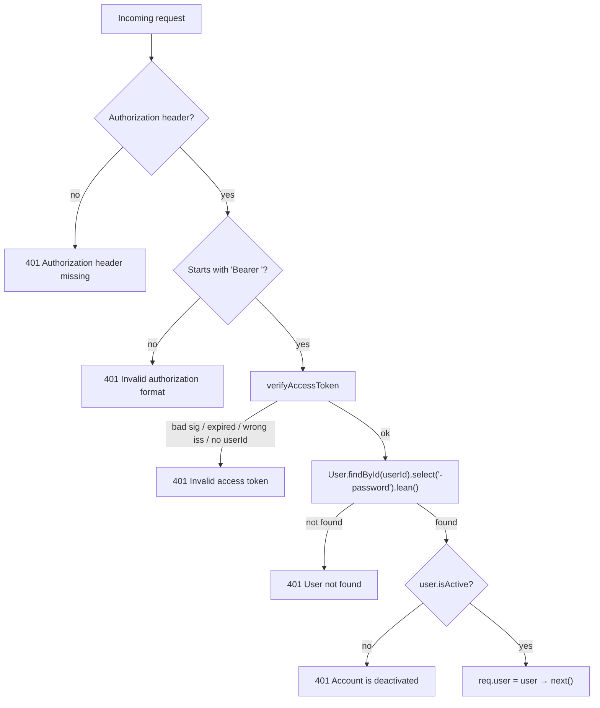
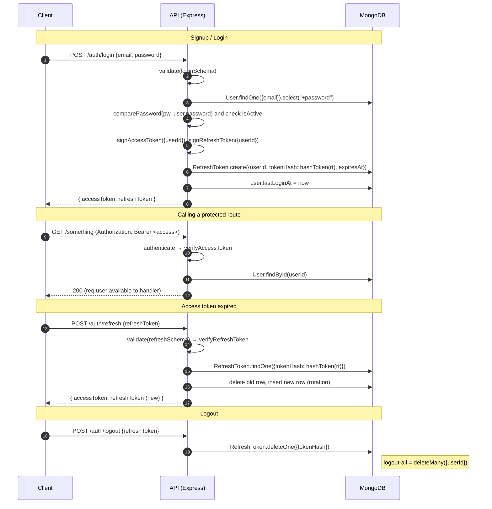

# Authentication — Current State

> **Status (as of 2026-10-05): building blocks only, not wired up.**
> The API has everything needed to do JWT auth: models, token utilities, password hashing, request validation and middleware. But **no auth endpoints exist yet** and **no route is protected**. The only live routes are `GET /health`, `/docs` and `/openapi.json`.

This document covers what exists, how the pieces are meant to fit together, and what's still missing.

---

## 1. The design in one paragraph

CSAT uses **stateless JWT access tokens** plus **stateful refresh tokens**. The client logs in with email and password and gets back two tokens:

- A short-lived **access token** (default 15 min). The client sends it as `Authorization: Bearer <token>` on every API call.
- A long-lived **refresh token** (default 30 days). The client trades it for a new access token when the old one expires. The server stores only a **SHA-256 hash** of each refresh token in MongoDB, so refresh tokens can be revoked.

Passwords are stored as **bcrypt(HMAC-SHA256(password, pepper))**.

---

## 2. Where everything lives

All paths are relative to `services/api/src/` unless noted.

| Concern               | File                                                                  | What it does                                                                                                                                                        |
| --------------------- | --------------------------------------------------------------------- | ------------------------------------------------------------------------------------------------------------------------------------------------------------------- |
| Config / secrets      | `packages/shared/src/config.ts`                                       | Loads `JWT_ACCESS_SECRET`, `JWT_REFRESH_SECRET`, `JWT_ACCESS_TTL`, `JWT_REFRESH_TTL`, `PASSWORD_PEPPER`. If a required secret is missing, the app refuses to start. |
| User model            | `models/user.ts`                                                      | Identity, `password` (hidden by default with `select: false`), `provider`, `role`, `accessScopes`, `isActive`, `lastLoginAt`                                        |
| Refresh-token model   | `models/refresh-token.ts`                                             | `{ userId, tokenHash, expiresAt }`, with a TTL index that auto-deletes expired tokens                                                                               |
| Input contracts       | `dto/auth.dto.ts`                                                     | Zod schemas `signupSchema`, `loginSchema`, `refreshSchema`                                                                                                          |
| Validation middleware | `middlewares/validate.ts`                                             | `validate(schema)` parses `req.body` and returns a 400 `ValidationError` on failure                                                                                 |
| Password hashing      | `utils/password.ts`                                                   | `hashPassword`, `comparePassword`                                                                                                                                   |
| Token utilities       | `utils/jwt.ts`                                                        | `signAccessToken`, `signRefreshToken`, `verifyAccessToken`, `verifyRefreshToken`, `hashToken`                                                                       |
| Auth middleware       | `middlewares/authenticate.ts`                                         | `authenticate` (verifies the Bearer token and loads `req.user`) and `requireRole([...])`                                                                            |
| `req.user` typing     | `types/express.d.ts`                                                  | Adds `req.user?: LeanUser` (a plain object without the password) to Express's `Request` type                                                                        |
| Errors                | `utils/errors.ts` + `middlewares/error-handler.ts`                    | `UnauthorizedError` → 401, `AppError(..., 403)` → 403, `ValidationError` → 400                                                                                      |
| API docs              | `docs/openapi.ts`, `docs/components.ts` + `packages/http/src/docs.ts` | Swagger UI at `/docs`, raw spec at `/openapi.json`, the `bearerAuth` scheme, and the auth request/`User` schemas (see §6a)                                          |

**Not present yet:** `routes/auth.ts`, `controllers/auth.ts`, `services/auth.ts`.

---

## 3. Configuration

From `.env.example`:

```env
JWT_ACCESS_SECRET=          # REQUIRED – HMAC key for access tokens
JWT_REFRESH_SECRET=         # REQUIRED – HMAC key for refresh tokens (must differ from access)
JWT_ACCESS_TTL=15m          # optional, default 15m
JWT_REFRESH_TTL=30d         # optional, default 30d
PASSWORD_PEPPER=            # REQUIRED – never change once users exist
```

- Missing secrets throw at startup (`required()` in `config.ts`). No weak default key is ever used.
- **If you change `PASSWORD_PEPPER`, every existing password hash stops working.** Treat it like a database encryption key.
- CI reads these values from the GitHub secrets `CI_JWT_ACCESS_SECRET`, `CI_JWT_REFRESH_SECRET` and `CI_PASSWORD_PEPPER`.

---

## 4. Data model

### `User`

```ts
{
  name, email (unique, lowercase), mobileNumber?, profileImage?,
  password?: string        // bcrypt hash; select:false; null for Google users
  provider: "local" | "google"
  role: "admin" | "user"   // default "user"
  accessScopes: [{ resourceType: "sbu" | "department", resourceId }]
  isActive: boolean        // default true
  lastLoginAt?: Date
}
```

`toJSON` removes `password` and `__v`, so a `User` document can't leak its password hash through `res.json()`.

### `RefreshToken`

```ts
{ userId → User, tokenHash (unique, sha256 hex), expiresAt, createdAt, updatedAt }
```

- **TTL index** (`expiresAt_ttl`): MongoDB deletes each row once `expiresAt` has passed.
- **Compound index** `{ userId, expiresAt }`: makes "log out from all devices" a fast query.
- Helpers: `RefreshToken.cleanupExpiredTokens(userId?)` and `doc.isExpired()`.

---

## 5. How each piece works

### 5.1 Password hashing (`utils/password.ts`)

```
stored = bcrypt( HMAC-SHA256(key = PEPPER, msg = password) → base64, cost = 12 )
```

- **Why the HMAC step first?** bcrypt ignores everything after 72 bytes. Pre-hashing turns any password into a 44-byte value that always includes the pepper.
- **Pepper:** a secret kept outside the database. If the database leaks without the server config, the hashes can't be cracked offline.
- `hashPassword` retries up to 3 times, 100 ms apart, then throws a 500 `AppError`.
- `comparePassword` repeats the same HMAC step and calls `bcrypt.compare`, which compares in constant time.
- The DTO also limits raw passwords to 72 bytes (UTF-8) as an input rule.

### 5.2 Tokens (`utils/jwt.ts`)

|                     | Access token           | Refresh token                             |
| ------------------- | ---------------------- | ----------------------------------------- |
| Secret              | `JWT_ACCESS_SECRET`    | `JWT_REFRESH_SECRET`                      |
| Lifetime            | `JWT_ACCESS_TTL` (15m) | `JWT_REFRESH_TTL` (30d)                   |
| Payload             | `{ userId }` only      | `{ userId }` only                         |
| Issuer (`iss`)      | `csat-api`             | `csat-api`                                |
| Stored server-side? | No                     | Yes, as `sha256(token)` in `RefreshToken` |

- **Payload allowlist:** only `userId` goes into a token. This is enforced by Semgrep's `jwt-exposed-data` rule in CI, so no personal data ends up in tokens.
- `verify*Token` checks the signature, expiry, issuer, and that `userId` is a string. Any failure becomes `UnauthorizedError` (401).
- `hashToken(token)` returns the SHA-256 hex digest. Only the hash is stored, so a database leak doesn't expose usable refresh tokens.

### 5.3 Input validation (`dto/auth.dto.ts`)

Every schema uses `.strict()`: **unknown keys are rejected**. This stops mass-assignment. A client can't send `role: "admin"`, `isActive` or `provider` in a signup body.

| Schema          | Fields                                       | Rules                                                                                                                                                     |
| --------------- | -------------------------------------------- | --------------------------------------------------------------------------------------------------------------------------------------------------------- |
| `signupSchema`  | `name`, `email`, `password`, `mobileNumber?` | name 2–100 chars; email trimmed, lowercased, valid format; password 8+ chars with at least one letter and one digit, max 72 bytes; mobile in E.164 format |
| `loginSchema`   | `email`, `password`                          | password only needs to be non-empty, so login doesn't reveal the password policy                                                                          |
| `refreshSchema` | `refreshToken`                               | non-empty string; the cryptographic check happens in the service layer                                                                                    |

### 5.4 `authenticate` middleware



It **looks up the user in the database on every request**. That costs one query per call, but it means deactivating or deleting a user cuts off access immediately, without waiting up to 15 minutes for the access token to expire.

### 5.5 `requireRole(roles)` middleware

Use it **after** `authenticate`:

- No `req.user` → 401.
- `req.user.role` not in `roles` → **403** "Insufficient permissions".

```ts
router.delete(
  "/users/:id",
  authenticate,
  requireRole(["admin"]),
  asyncHandler(handler)
);
```

---

## 6. The intended end-to-end flow (not implemented yet)

The DTOs name the endpoints as `POST /auth/signup`, `/auth/login` and `/auth/refresh`. Wiring the existing utilities together gives this flow:



---

## 6a. Swagger / API docs

Swagger is the **source of truth for endpoint details**. This section only explains how it's put together.

### Documented routes

These are all the routes the app serves today. A unit test checks that this list matches the real routes exactly.

| Method | Path            | Auth   | Responses documented          | Notes                                                                      |
| ------ | --------------- | ------ | ----------------------------- | -------------------------------------------------------------------------- |
| `GET`  | `/health`       | Public | `200` ok, `503` degraded      | Example bodies for both. Reads in-memory Mongo state only, no DB query.    |
| `GET`  | `/openapi.json` | Public | `200` JSON spec               | Use for client code generation or importing into Postman/Insomnia.         |
| `GET`  | `/docs`         | Public | `301` → `/docs/`, `200` HTML  | Swagger UI. Has its own relaxed CSP, scoped to this path only.             |
| any    | anything else   | –      | `404` `{"error":"Not Found"}` | Described in the spec's intro, since a catch-all can't be an OpenAPI path. |

Open it locally at <http://localhost:4000/docs>.

### What the spec contains

| Part               | Contents                                                                                                                                                                                                                   |
| ------------------ | -------------------------------------------------------------------------------------------------------------------------------------------------------------------------------------------------------------------------- |
| `info.description` | Markdown intro: route table, auth status and design, error status codes, the 100 kb body limit                                                                                                                             |
| `tags`             | `Health`, `Docs`                                                                                                                                                                                                           |
| `securitySchemes`  | `bearerAuth`: HTTP bearer JWT, with the token lifetime, signing details and per-request user reload explained                                                                                                              |
| `schemas`          | `HealthReport`, `ErrorResponse` (including the development-only `stack`/`message`/`details` fields), `User`, `AccessScope`, `SignupRequest`, `LoginRequest`, `RefreshRequest`                                              |
| `responses`        | Reusable `BadRequest`, `Unauthorized`, `Forbidden`, `NotFound`, `InternalServerError`, each with the **exact** error messages the code throws (for example, `Unauthorized` lists all six 401 messages from `authenticate`) |

The auth request schemas and `User` are defined **ahead of** the `/auth/*` endpoints, so those routes only need to `$ref` them. The `/auth/*` operations are deliberately **not** in the spec yet: those routes don't exist, so "Try it out" would just return 404.

### How it's built

| File                                  | Role                                                                                                                                                                  |
| ------------------------------------- | --------------------------------------------------------------------------------------------------------------------------------------------------------------------- |
| `services/api/src/docs/openapi.ts`    | Base definition (info, servers, tags), plus `@openapi` blocks for `/docs` and `/openapi.json`. Those two routes are mounted by `@csat/http` rather than a route file. |
| `services/api/src/docs/components.ts` | All reusable components. Each one has a comment naming the code it mirrors.                                                                                           |
| `services/api/src/routes/*.ts`        | `@openapi` block above each route handler                                                                                                                             |
| `packages/http/src/docs.ts`           | `buildOpenApiSpec` (swagger-jsdoc) and `mountDocs` (Swagger UI and CSP)                                                                                               |

`buildOpenApiSpec` converts glob paths to forward slashes. Without that, Windows paths match no files and Swagger shows zero endpoints.

### Guard-rail tests (`tests/unit/api/docs.test.ts`)

- The documented paths equal the real routes, and each live response status is one the spec declares.
- Every `$ref` resolves.
- `SignupRequest`, `LoginRequest` and `RefreshRequest` contain every constraint from `z.toJSONSchema()` of the matching DTO. If you change a DTO without updating the spec, the test fails.
- `bearerAuth` exists and isn't applied to the whole spec, so `/health` stays public.

### Documenting a protected route

The scheme is **not** applied to the whole spec. Each protected route opts in, and the reusable responses keep its annotation short:

```ts
/**
 * @openapi
 * /surveys:
 *   get:
 *     operationId: listSurveys
 *     summary: List surveys
 *     tags: [Surveys]
 *     security:
 *       - bearerAuth: []
 *     responses:
 *       200: { description: OK }
 *       401: { $ref: '#/components/responses/Unauthorized' }
 *       403: { $ref: '#/components/responses/Forbidden' }
 */
router.get(
  "/surveys",
  authenticate,
  requireRole(["admin"]),
  asyncHandler(listSurveys)
);
```

Public endpoints such as `/auth/signup`, `/auth/login` and `/auth/refresh` leave out `security` and use `$ref: '#/components/schemas/SignupRequest'` (and so on) for the `requestBody`.

When you add a route, also add it to the expected-paths list in `docs.test.ts`.

---

## 7. Gaps and things to fix before this goes live

### Not built yet

1. **No auth routes, controllers or services.** Signup, login, refresh and logout all need to be written and mounted in `routes/index.ts`.
2. **No route uses `authenticate`.** Nothing is protected today.
3. **Google sign-in** (`provider: "google"`) is in the schema but has no OAuth flow behind it.
4. **`accessScopes`** (SBU/department access) is stored but never checked. It needs something like a `requireScope(resourceType, idParam)` middleware.
5. **`lastLoginAt`** is never set.
6. **`/auth/*` operations aren't in Swagger yet.** Their request and `User` schemas, the `bearerAuth` scheme, and the error responses are all ready (see §6a). Only the path entries need adding, together with the routes.
7. **No rate limiting or lockout** on login. It's needed to slow down password guessing.

### Problems in the existing code

8. **Refresh tokens can collide.** The token payload is just `{ userId, iat, exp, iss }` and `iat` is in whole seconds. Two refresh tokens issued to the same user in the same second (for example, two logins or a quick rotation) are **byte-identical**, so the second insert fails the unique `tokenHash` index. **Fix:** add a random `jwtid` (`crypto.randomUUID()`) when signing refresh tokens.
9. **Access and refresh tokens look the same except for the secret.** Both use issuer `csat-api` and neither has a `typ` or `aud` claim. If someone sets both secrets to the same value, a refresh token would work as an access token. **Fix:** add `audience: "access"` / `"refresh"`, or a `typ` claim, and/or check at startup that the two secrets differ.
10. **Email rules don't match.** Zod's `z.email()` accepts `user+tag@example.com`, but the Mongoose regex in `user.ts` (`[\w-]+…`) rejects `+`. Mongoose's `ValidationError` isn't an `AppError`, so that signup would return a **500** instead of a 400. Align the two rules, or map Mongoose validation errors to 400.
11. **Raw JWT library messages reach the client**, e.g. `"Invalid access token: jwt expired"`. This is harmless but chatty. Consider fixed messages, and return a stable code such as `token_expired` so the frontend knows to refresh.
12. **Refresh rotation and reuse detection** don't exist yet. When the service is written: delete the old row on every refresh, and if a token is valid by signature but missing from the database (meaning it was reused), revoke all of that user's tokens.
13. **Refresh-token transport isn't decided.** It currently arrives in the JSON body. An `httpOnly; Secure; SameSite` cookie is safer for browser clients (`trust proxy` is already set in `app.ts`). The DTO comments already describe this option.

---

## 8. Tests

| Area                           | Test file                                         |
| ------------------------------ | ------------------------------------------------- |
| DTOs                           | `tests/unit/api/dto/auth.dto.test.ts`             |
| JWT utilities                  | `tests/unit/api/utils/jwt.test.ts`                |
| Password hashing               | `tests/unit/api/utils/password.test.ts`           |
| `authenticate` / `requireRole` | `tests/unit/api/middlewares/authenticate.test.ts` |
| Config (required secrets)      | `tests/unit/shared/config.test.ts`                |

There are no integration tests for auth yet, because there are no auth endpoints to call.
